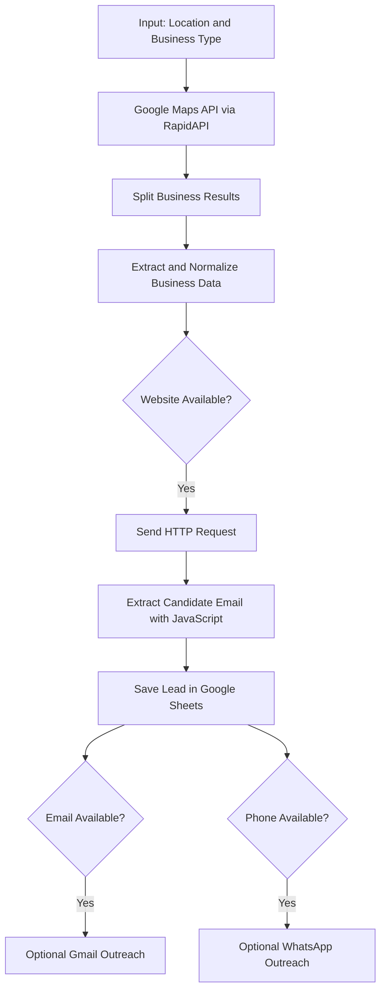

# Lead Finding Automation

An n8n-based automation workflow that streamlines local-business lead discovery by collecting business details from a Google Maps scraping API, visiting available business websites to identify publicly listed email addresses, and organizing the results in Google Sheets.

The workflow also includes optional Gmail and WhatsApp outreach branches.

> **Project Status:** Workflow export documented. End-to-end execution and behavior must be tested in the target n8n instance before claiming production readiness.

## Problem Statement

Manual lead generation involves repetitive tasks such as searching for businesses, collecting contact information, visiting websites, finding email addresses, and organizing leads.

This project automates several of these tasks using n8n, APIs, JavaScript, and Google Sheets, helping reduce manual research effort.

## Key Features

- Search for businesses by location and business category.
- Retrieve business information using a Google Maps scraping API.
- Extract business names, addresses, phone numbers, websites, ratings, and review counts.
- Automatically visit available business websites.
- Identify candidate email addresses using JavaScript regular expressions.
- Store collected lead information in Google Sheets.
- Includes optional Gmail and WhatsApp outreach branches.

## Workflow Architecture



## Technologies Used

- **n8n:** Workflow automation and orchestration.
- **RapidAPI:** Google Maps business data retrieval.
- **HTTP Request:** Website data collection.
- **JavaScript:** Email pattern extraction and data processing.
- **Google Sheets:** Lead storage and organization.
- **Gmail:** Optional email outreach.
- **WhatsApp Business Cloud API:** Optional WhatsApp outreach.

## Information Collected

| Field | Description |
|---|---|
| Business Name | Name of the business |
| Address | Business location |
| Phone Number | Public business contact number |
| Website | Business website URL |
| Rating | Business rating |
| Reviews | Number of reviews |
| Google Maps URL | Business Maps link |
| Email | Candidate email extracted from website HTML |

**Note:** Email extraction is pattern-based. It does not verify whether an email address is active, valid, or deliverable.

## How It Works

1. The user submits a location and business category through an n8n form.
2. The workflow sends the search request to a Google Maps scraping API through RapidAPI.
3. The returned business records are split into individual items.
4. Business information is extracted and normalized into structured fields.
5. Businesses with websites are passed to an HTTP Request node.
6. The website HTML is processed using JavaScript to identify candidate email addresses.
7. Business information and extracted emails are stored in Google Sheets.
8. Optional Gmail and WhatsApp branches can process records with available contact details.

## Installation and Setup

### Prerequisites

- An active n8n instance.
- RapidAPI access for the Google Maps scraping endpoint.
- Google Sheets account and OAuth credentials.
- Gmail credentials (optional).
- WhatsApp Business Cloud API credentials (optional).

### Import Workflow

1. Download or clone this repository.
2. Open your n8n instance.
3. Navigate to Workflows.
4. Select Import from File.
5. Import the JSON file from:

   `workflow/lead-finding-automation.sanitized.json`

6. Configure the required API credentials.
7. Connect your Google Sheets account and select your spreadsheet.
8. Configure Gmail and WhatsApp credentials if you intend to use those optional branches.
9. Review the node configurations and API response mappings.
10. Test the workflow with a small sample before activating it.

## Repository Structure

```text
lead-finding-automation/
│
├── README.md
│
├── docs/
│   └── implementation-notes.md
│
├── workflow/
│   └── lead-finding-automation.sanitized.json
│
└── screenshots/
```

## Limitations and Future Improvements

- Implement email verification to check email deliverability.
- Add duplicate lead detection using a stable business identifier.
- Improve error handling and API retry mechanisms.
- Add rate limiting for external API requests.
- Add a manual approval step before sending outreach messages.
- Improve handling of websites that block automated requests or return incomplete HTML.

## Security and Responsible Use

- Never upload API keys, passwords, access tokens, or private credentials to GitHub.
- Configure credentials securely inside n8n.
- Respect website terms of service, API provider policies, rate limits, and applicable privacy laws.
- Review recipient consent, opt-out requirements, and applicable rules before sending outreach.
- Keep automated Gmail and WhatsApp outreach disabled until properly configured and tested.
- Do not collect or store unnecessary sensitive personal information.

## Author

**Shahzaib Khan**

AI Automation Intern — Logitrix Solutions  
BS Computer Science — University of Central Punjab

**Areas of Interest:** AI Automation | Python | n8n | APIs | Agentic AI | Software Development

## Disclaimer

This project is developed for educational and demonstration purposes. The author is responsible for configuring third-party services and ensuring that the workflow is used in accordance with applicable laws, platform policies, and service terms.
